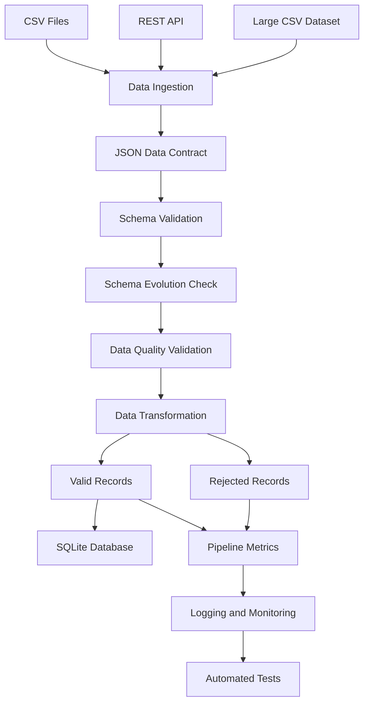

# Data Contract & Schema Evolution Validation Pipeline

A Python-based data engineering project that validates customer data from CSV files and REST APIs using JSON-based data contracts. It detects schema changes, performs data quality checks, separates valid and rejected records, and tracks pipeline execution through logging, metrics, and automated tests.

## Project Overview

Data pipelines often receive data from multiple sources with missing fields, incorrect data types, duplicate records, and unexpected schema changes.

This project introduces a contract-driven validation approach to identify these issues before unreliable data moves further into the pipeline.

## Architecture



## Key Features

### 1. Multiple Data Sources
- Read customer records from CSV files.
- Ingest customer data from REST APIs.
- Process datasets containing 100,000 records.

### 2. Data Contract Validation
- Define expected schemas using JSON contracts.
- Validate required and optional columns.
- Check expected data types.
- Identify breaking and non-breaking schema changes.

### 3. Data Quality Checks
- Validate required fields.
- Check email formats.
- Detect duplicate customer IDs.
- Validate minimum and maximum values.
- Capture validation errors and separate rejected records.

### 4. Data Transformation
- Standardize customer names and city values.
- Normalize email addresses.
- Convert numeric columns to appropriate data types.

### 5. Database Publishing
- Store validated customer records in SQLite.
- Use customer IDs to support record updates.

### 6. Logging and Monitoring
- Record pipeline execution details.
- Track run IDs and processing timestamps.
- Capture valid and rejected record counts.
- Generate execution metrics.

### 7. Automated Testing
- Test API ingestion and retry behavior.
- Test schema compatibility.
- Test data quality validation.
- Test transformations and pipeline metadata.

## Technology Stack

| Technology | Purpose |
|---|---|
| Python | Pipeline development |
| Pandas | Data processing and validation |
| JSON | Data contract definitions |
| REST API | External data ingestion |
| SQLite | Database publishing |
| Pytest | Automated testing |
| Requests | API communication |
| Git & GitHub | Version control |

## Project Structure

```text
data-contract-validation-pipeline/
│
├── config/
│   ├── customer_api_contract.json
│   ├── customer_contract.json
│   ├── customer_contract_v1.json
│   └── customer_contract_breaking.json
│
├── src/
│   ├── api_ingestion.py
│   ├── contract_validator.py
│   ├── data_quality.py
│   ├── database.py
│   ├── generate_test_data.py
│   ├── ingestion.py
│   ├── logger.py
│   ├── main.py
│   ├── monitoring.py
│   ├── publisher.py
│   ├── schema_compatibility.py
│   ├── transform.py
│   └── transformation.py
│
├── tests/
│   ├── test_api_ingestion.py
│   ├── test_contract.py
│   ├── test_idempotency.py
│   ├── test_ingestion.py
│   ├── test_pipeline.py
│   └── test_quality.py
│
├── .gitignore
├── requirements.txt
├── run_api_pipeline.py
├── run_benchmark.py
├── run_ingestion.py
├── test_schema_evolution.py
└── README.md
```

Generated datasets, logs, database files, and reports are excluded from version control.

## Installation and Setup

### 1. Clone the repository

```bash
git clone https://github.com/Teja-Bashetti/data-contract-validation-pipeline.git
```

### 2. Navigate to the project

```bash
cd data-contract-validation-pipeline
```

### 3. Create a virtual environment

```bash
python -m venv .venv
```

### 4. Activate the environment (Windows)

```powershell
.venv\Scripts\Activate.ps1
```

### 5. Install dependencies

```bash
pip install -r requirements.txt
```

## Running the Pipelines

### CSV Data Pipeline

```bash
python run_ingestion.py
```

### REST API Pipeline

```bash
python run_api_pipeline.py
```

### Generate 100,000 Test Records

```bash
python -m src.generate_test_data
```

### Run Performance Benchmark

```bash
python run_benchmark.py
```

## Automated Testing

Execute the test suite:

```bash
pytest -v
```

**Latest verified test result:** 16 passed.

## Performance Benchmark

Latest recorded benchmark for 100,000 customer records:

| Metric | Result |
|---|---:|
| Total records | 100,000 |
| Valid records | 100,000 |
| Rejected records | 0 |
| Input memory usage | 19.55 MB |
| Processing time | 2.174 seconds |
| Success rate | 100% |

Performance results may vary depending on the execution environment.

## Pipeline Outputs

The pipeline generates:

- Valid customer records.
- Rejected records with validation details.
- SQLite database records.
- Pipeline execution logs.
- Run metrics and benchmark reports.

These generated files are kept locally and excluded from the GitHub repository.

## Engineering Concepts Demonstrated

- Data ingestion from multiple sources.
- Contract-driven data validation.
- Schema evolution and compatibility checks.
- Data quality frameworks.
- Data transformation.
- API integration and retry handling.
- Database publishing.
- Logging and monitoring.
- Automated testing.
- Performance benchmarking.

## Future Enhancements

- AWS S3 integration.
- AWS Glue data processing.
- Amazon Redshift publishing.
- Workflow orchestration using Apache Airflow.
- Docker-based deployment.
- Data quality monitoring dashboard.

---

**Project:**Data Contract & Schema Evolution Validation Pipeline  
**Language:**Python  
**Repository:** [GitHub](https://github.com/Teja-Bashetti/data-contract-validation-pipeline)