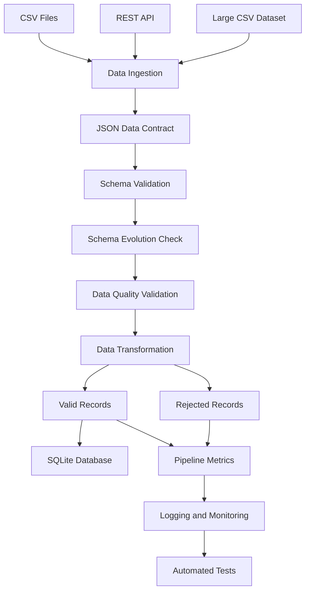

# Data Contract & Schema Evolution Validation Pipeline

A Python-based data engineering project that validates customer data from CSV files and REST APIs using JSON-based data contracts.

The pipeline detects schema changes, performs data quality checks, separates valid and rejected records, transforms customer data, publishes records into SQLite, and tracks execution through logging, metrics, and automated tests.

It also includes an AI-assisted data contract generator using a locally hosted Ollama model.

## Project Overview

Data pipelines often receive data from multiple sources with missing fields, incorrect data types, duplicate records, and unexpected schema changes.

This project introduces a contract-driven validation approach to identify these issues before unreliable data moves further into the pipeline.

## Architecture



## Key Features

### 1. Multiple Data Sources

- Read customer records from CSV files.
- Ingest customer data from REST APIs.
- Process datasets containing 100,000 records.

### 2. Data Contract Validation

- Define expected schemas using JSON contracts.
- Validate required and optional columns.
- Check expected data types.
- Identify breaking and non-breaking schema changes.

### 3. Data Quality Checks

- Validate required fields.
- Check email formats.
- Detect duplicate customer IDs.
- Validate minimum and maximum values.
- Capture validation errors.
- Separate valid and rejected records.

### 4. Data Transformation

- Standardize customer names and city values.
- Normalize email addresses.
- Convert numeric columns to appropriate data types.
- Preserve the original input DataFrame.

### 5. Database Publishing and Idempotency

- Publish validated customer records into SQLite.
- Use customer IDs as primary keys.
- Insert new customer records.
- Update existing records using SQLite UPSERT.
- Test repeated publishing to ensure duplicate customer records are not created.

### 6. SQL Demonstration

Includes SQL queries to:

- View published customer records.
- Count total customers.
- Group customers by city.
- Filter customers by age.
- Check duplicate customer IDs.
- Review pipeline metadata.
- Count records by pipeline run.

### 7. AI-Assisted Data Contract Generation

Uses a locally hosted Ollama model (`qwen2.5:1.5b`) to suggest a JSON data contract from a CSV sample.

The AI generator:

- Reads CSV columns and sample records.
- Sends the sample to a local language model.
- Generates a proposed JSON contract.
- Checks the basic structure and supported rules.
- Saves the proposal separately from the production contract.

**Important:** AI-generated contracts are suggestions. They must be reviewed before being used in production. Actual pipeline validation remains rule-based and deterministic.

### 8. Logging and Monitoring

- Record pipeline execution details.
- Track run IDs and processing timestamps.
- Capture valid and rejected record counts.
- Generate execution metrics.

### 9. Automated Testing

- Test API ingestion and retry behavior.
- Test schema compatibility.
- Test data quality validation.
- Test transformations and pipeline metadata.
- Test database idempotency.

## Technology Stack

| Technology | Purpose |
|---|---|
| Python | Pipeline development |
| Pandas | Data processing and validation |
| JSON | Data contract definitions |
| REST API | External data ingestion |
| SQLite | Database publishing |
| SQL | Data querying |
| Pytest | Automated testing |
| Requests | API communication |
| Ollama | Local AI contract generation |
| Qwen 2.5 1.5B | Local language model |
| Git & GitHub | Version control |

## Project Structure

```text
data-contract-validation-pipeline/
│
├── config/
│   ├── customer_api_contract.json
│   ├── customer_contract.json
│   ├── customer_contract_v1.json
│   ├── customer_contract_breaking.json
│   └── customer_contract_ai_proposal.json
│
├── data/
│   ├── input/
│   ├── valid/
│   ├── rejected/
│   └── customer_data.db
│
├── docs/
│   └── TROUBLESHOOTING.md
│
├── logs/
├── reports/
│
├── sql/
│   └── demo_queries.sql
│
├── src/
│   ├── __init__.py
│   ├── api_ingestion.py
│   ├── contract_validator.py
│   ├── data_quality.py
│   ├── database.py
│   ├── generate_test_data.py
│   ├── ingestion.py
│   ├── logger.py
│   ├── main.py
│   ├── monitoring.py
│   ├── publisher.py
│   ├── schema_compatibility.py
│   ├── transform.py
│   └── transformation.py
│
├── tests/
│   ├── test_api_ingestion.py
│   ├── test_contract.py
│   ├── test_idempotency.py
│   ├── test_ingestion.py
│   ├── test_pipeline.py
│   └── test_quality.py
│
├── ai_contract_generator.py
├── run_api_pipeline.py
├── run_benchmark.py
├── run_sql_demo.py
├── requirements.txt
├── .gitignore
└── README.md
```

Generated datasets, logs, database files, and reports are kept locally and excluded from version control where configured.

## Installation and Setup

### 1. Clone the repository

```bash
git clone https://github.com/Teja-Bashetti/data-contract-validation-pipeline.git
```

### 2. Navigate to the project

```bash
cd data-contract-validation-pipeline
```

### 3. Create a virtual environment

```bash
python -m venv .venv
```

### 4. Activate the environment (Windows)

```powershell
.venv\Scripts\Activate.ps1
```

### 5. Install dependencies

```bash
pip install -r requirements.txt
```

## Running the Pipeline

### CSV Data Pipeline

```bash
python run_ingestion.py
```

### REST API Pipeline

```bash
python run_api_pipeline.py
```

### Generate 100,000 Test Records

```bash
python -m src.generate_test_data
```

### Run Performance Benchmark

```bash
python run_benchmark.py
```

## SQL Demonstration

First run the pipeline so that customer records are available in SQLite.

Then execute:

```bash
python run_sql_demo.py
```

The SQL queries are also available in:

```text
sql/demo_queries.sql
```

## AI Contract Generation

The AI feature is optional. The main data pipeline does not require Ollama.

### 1. Install Ollama

Download and install Ollama from:

https://ollama.com/

### 2. Download the model

```bash
ollama pull qwen2.5:1.5b
```

### 3. Generate an AI contract proposal

```bash
python ai_contract_generator.py
```

The generated proposal is saved to:

```text
config/customer_contract_ai_proposal.json
```

Review the proposal before considering it for production use.

## Automated Testing

Run the complete test suite:

```bash
python -m pytest -v
```

**Latest verified result: 20 passed in 1.80 seconds.**
The test suite includes API retry handling, schema compatibility, data quality validation, transformations, metadata checks, and database idempotency.

## Performance Benchmark

Latest recorded benchmark for 100,000 customer records:

| Metric | Result |
|---|---:|
| Total records | 100,000 |
| Valid records | 100,000 |
| Rejected records | 0 |
| Input memory usage | 19.55 MB |
| Processing time | 2.174 seconds |
| Success rate | 100% |

Performance results may vary depending on the execution environment and input data.

## Pipeline Outputs

The pipeline generates:

- Valid customer records.
- Rejected records with validation details.
- SQLite database records.
- Pipeline execution logs.
- Run metrics and benchmark reports.
- AI-generated contract proposals.

These generated files are kept locally and excluded from the GitHub repository where configured.

## Troubleshooting

For common installation, execution, database, testing, and Ollama errors, see:

[docs/TROUBLESHOOTING.md](docs/TROUBLESHOOTING.md)

## Engineering Concepts Demonstrated

- Data ingestion from multiple sources.
- Contract-driven data validation.
- Schema evolution and compatibility checks.
- Data quality frameworks.
- Data transformation.
- API integration and retry handling.
- SQLite database publishing and UPSERT.
- Idempotent data processing.
- SQL querying.
- AI-assisted data contract generation.
- Logging and monitoring.
- Automated testing.
- Performance benchmarking.

## Customer History Tracking (SCD Type 2)

The pipeline maintains customer change history using Slowly Changing Dimension Type 2.

When a customer's business attributes change:
- The previous history record is closed using `effective_to` and `is_current = 0`.
- A new version is inserted with `effective_to = NULL` and `is_current = 1`.
- Unchanged customer data does not create another history version.
- Changes to run metadata alone do not create a history version.

The `customers` table stores the latest customer state. The `customer_history` table preserves tracked versions.

### Customer Data Dictionary

#### customers

| Column | Description |
|---|---|
| customer_id | Unique customer identifier and primary key |
| customer_name | Customer name |
| email | Customer email address |
| age | Customer age |
| city | Customer city |
| phone_number | Customer phone number |
| run_id | Pipeline execution identifier |
| source_file | Source file name |
| processed_at | Processing timestamp in ISO-8601 format |

#### customer_history

| Column | Description |
|---|---|
| history_id | Unique history record identifier |
| customer_id | Customer business identifier |
| customer_name | Customer name for this version |
| email | Customer email for this version |
| age | Customer age for this version |
| city | Customer city for this version |
| phone_number | Customer phone number for this version |
| effective_from | Start timestamp of this version |
| effective_to | End timestamp; NULL for current version |
| is_current | 1 for current version; 0 for historical version |
| run_id | Pipeline execution identifier |
| source_file | Source file name |
| processed_at | Processing timestamp |

### SCD Type 2 Tests

Automated tests cover:
- Initial customer history insertion.
- Customer updates preserving previous versions.
- Identical reruns not creating additional history versions.

### Known Limitation

Historical versions are preserved from the point history tracking is enabled. Backfilling existing customers creates an initial snapshot; it cannot reconstruct changes from before implementation.

## Future Enhancements

- AWS S3 integration.
- AWS Glue data processing.
- Amazon Redshift publishing.
- Workflow orchestration using Apache Airflow.
- Docker-based deployment.
- Data quality monitoring dashboard.

---

**Project:** Data Contract & Schema Evolution Validation Pipeline
**Language:** Python
**Repository:** [GitHub](https://github.com/Teja-Bashetti/data-contract-validation-pipeline)
